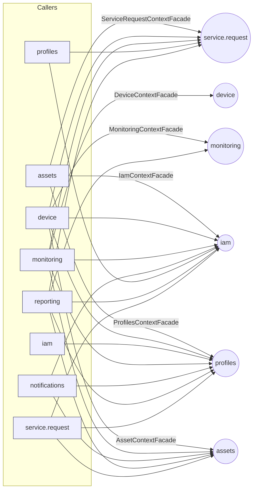
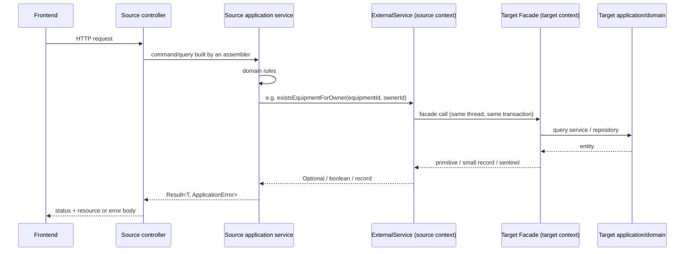

# Inter-bounded-context communication

Contexts never import each other's domain or application classes. There are exactly three mechanisms, found by reading every `interfaces/acl`, every `application/internal/outboundservices/acl` and every `@EventListener`:

| Mechanism | Direction | Style |
|---|---|---|
| **Facade** (inbound, `<ctx>/interfaces/acl/*ContextFacade`) called by an **ExternalService** (outbound, `<caller>/application/internal/outboundservices/acl/*`) | caller -> target, request/response | Synchronous, in the caller's thread and transaction. Concrete classes, no interface |
| **Integration events** (`<ctx>/interfaces/events/*IntegrationEvent`) consumed by listeners in other contexts | publisher -> subscribers | In-process Spring events; Service Request uses a transactional outbox |
| **Technical provider ports** (`.../outboundservices/geocoding`, `storage`, `push`, `google`, `tokens`, `credentials`, `addressvalidation`, `streaming`) | context -> infrastructure adapter | Not inter-context; these call Google Maps, GCS, FCM, Google JWKS, or in-memory services. Do not confuse them with the ACL |

## 1. Inbound Facades

| Facade (owner) | Methods exposed | Called by (ExternalService) | Delegates to |
|---|---|---|---|
| `IamContextFacade` (iam) | `fetchUserIdByUsername(String) -> Long` (0 when missing), `fetchUsernameByUserId(Long) -> String` (empty when missing), `existsUserById(Long) -> boolean` | `AssetsExternalOwnerService`, `AssetsExternalServiceRequestService`, `DeviceExternalOwnerService`, `ExternalProfilesServiceForMonitoring`, `ExternalProfilesServiceForNotifications`, `ExternalIamService` (profiles), `ExternalProfilesServiceForReporting`, `ExternalUserProfileService` (service request) | `UserQueryService` |
| `ProfilesContextFacade` (profiles) | `createOwnerProfile(...)`, `createTechnicianProfile(...)`, `existsProfileByUserId`, `fetchEmailByUserId`, `fetchUserIdByEmail`, `fetchOwnerIdByUserId`, `fetchTechnicianIdByUserId`, `isTechnicianEligibleForAssignment` | `ExternalProfileService` (iam), `AssetsExternalOwnerService`, `AssetsExternalServiceRequestService`, `DeviceExternalOwnerService`, `ExternalProfilesServiceForMonitoring`, `ExternalProfilesServiceForNotifications`, `ExternalProfilesServiceForReporting`, `ExternalUserProfileService` | `OwnerCommandService`, `TechnicianCommandService`, `ProfileRepository`, `TechnicianProfileRepository` |
| `AssetContextFacade` (assets) | `getEquipmentThreshold`, `getEquipmentThresholdRange`, `getEquipmentConfigVersion`, `getEquipmentOwnerId`, `existsEquipmentForOwner`, `existsSiteForOwner`, `getSiteIdByEquipment`, `fetchEquipmentIdsBySite`, `getEquipmentIdByUid`, `recordEquipmentReading`, `markEquipmentOffline`, `fetchOnlineEquipmentIds`, `fetchEquipmentSummariesByOwner`, `fetchEquipmentSummary`, `countSitesByOwner`, `fetchEquipmentStatusNames` | `ExternalAssetManagementServiceForDevice`, `ExternalAssetManagementService` (monitoring), `ExternalAssetManagementServiceForNotifications`, `ExternalAssetsServiceForReporting`, `ExternalEquipmentService` (service request) | `EquipmentRepository`, `SiteRepository` (direct reads); `EquipmentCommandService` (telemetry writes) |
| `ServiceRequestContextFacade` (service.request) | `fetchActiveEdgeGrants`, `fetchEquipmentIdsWithCompletedPreventiveMaintenanceInRange`, `countCompletedServiceRequestsByTechnicianInRange`, `fetchAverageRatingByTechnician`, `hasActiveAssignmentOnEquipment`, `hasActiveAssignmentAtSite`, `hasActiveEngagementBetween`, `findInProgressServiceRequestAt`, `countServiceRequestsByStatus` | `AssetsExternalServiceRequestService`, `ExternalServiceRequestServiceForDevice`, `ExternalServiceRequestServiceForMonitoring`, `ExternalServiceRequestService` (profiles), `ExternalServiceRequestsServiceForReporting` | `ServiceRequestRepository`, `ReviewRepository`, `EdgeGrantRepository` (direct) |
| `MonitoringContextFacade` (monitoring) | `fetchApplicableAlertPolicy`, `countOpenAlertsByEquipment`, `fetchLatestAlertIdByEquipmentAndStatus`, `countAlertsByEquipmentAndTypeInRange`, `fetchTotalAlertDurationHoursByEquipmentAndTypeInRange`, `fetchTemperatureSamplesByEquipmentInRange` | `ExternalMonitoringServiceForDevice`, `ExternalMonitoringServiceForReporting` | `AlertRepository`, `AlertPolicyRepository`, `MaintenanceWindowRepository`, `SensorReadingRepository` (direct) |
| `DeviceContextFacade` (device) | `recordActivity(Long deviceId, Instant seenAt)`, `countLinkedDevices(Collection<Long> equipmentIds)` | `ExternalDeviceServiceForMonitoring` (monitoring) | `DeviceCommandService`; `DeviceRepository` (direct, for the count) |
| `NotificationsContextFacade` (notifications) | `countUnreadNotificationsByRecipient(Long)` | **nobody** | `NotificationQueryService` |
| `ReportingContextFacade` (reporting) | `countReportsByUser(Long)`, `fetchLatestReportStatusByUser(Long)` | **nobody** | `ReportRepository` (direct) |

Small transfer records live beside the facades: `AlertPolicySettings`, `ActiveEdgeGrant`, `InProgressServiceRequest`, `EquipmentSummary`, `LinkedDeviceCounts`, `ServiceRequestStatusCount`. Facade methods use primitive/`Long`/`double[]` values and sentinel results (`0L`, empty string) instead of exposing domain types.

## 2. Outbound ExternalServices (caller -> target)

| Caller context | ExternalService class | Target Facade | Methods invoked | Data transferred / translation |
|---|---|---|---|---|
| assets | `AssetsExternalOwnerService` | `IamContextFacade`, `ProfilesContextFacade` | `fetchUserIdByUsername`, `fetchOwnerIdByUserId` | username -> user id -> owner profile id (`Optional<Long>`, 0 mapped to empty) |
| assets | `AssetsExternalServiceRequestService` | `IamContextFacade`, `ProfilesContextFacade`, `ServiceRequestContextFacade` | `fetchUserIdByUsername`, `fetchTechnicianIdByUserId`, `hasActiveAssignmentOnEquipment`, `hasActiveAssignmentAtSite` | Decides whether a technician may read a unit/site |
| device | `DeviceExternalOwnerService` | iam, profiles | `fetchUserIdByUsername`, `fetchOwnerIdByUserId` | owner of the caller |
| device | `ExternalAssetManagementServiceForDevice` | `AssetContextFacade` | `existsEquipmentForOwner`, `existsSiteForOwner`, `getEquipmentConfigVersion`, `getEquipmentThresholdRange`, `fetchEquipmentSummariesByOwner`, `fetchEquipmentSummary` | ownership check when pairing; edge config thresholds; the owner's units scope the device inventory and give each device its unit name and site (`EquipmentSummary` -> `PairedEquipment`) |
| device | `ExternalMonitoringServiceForDevice` | `MonitoringContextFacade` | `fetchApplicableAlertPolicy` | `AlertPolicySettings` -> `AlertPolicyValues` for the edge config |
| device | `ExternalServiceRequestServiceForDevice` | `ServiceRequestContextFacade` | `fetchActiveEdgeGrants` | `ActiveEdgeGrant` -> `EdgeConfiguration.Grant` (SHA-256 digest, technician id, request id, expiry) |
| iam | `ExternalProfileService` | `ProfilesContextFacade` | `createOwnerProfile`, `createTechnicianProfile`, `fetchEmailByUserId`, `fetchUserIdByEmail` | Registration data -> profile creation; facade failures are rethrown as `IllegalArgumentException` (validation) or `IllegalStateException` (conflict) and mapped by `UserCommandServiceImpl.registerWithProfile` |
| monitoring | `ExternalAssetManagementService` | `AssetContextFacade` | `getEquipmentThresholdRange`, `existsEquipmentForOwner`, `getEquipmentOwnerId`, `recordEquipmentReading`, `markEquipmentOffline`, `fetchOnlineEquipmentIds`, `existsSiteForOwner`, `fetchEquipmentSummariesByOwner`, `countSitesByOwner`, `fetchEquipmentStatusNames` | thresholds for ingestion, ownership for reads/stream routing; keeps the unit's `online` / last reading in step with ingestion and offline detection; the owner's units scope the owner-wide alert, policy and dashboard reads (`EquipmentSummary` -> `MonitoredEquipment`) |
| monitoring | `ExternalDeviceServiceForMonitoring` | `DeviceContextFacade` | `recordActivity`, `countLinkedDevices` | the device's `last_seen_at` follows every stored reading batch; paired and revoked device totals of the dashboard (`LinkedDeviceCounts` -> `LinkedDeviceTotals`) |
| monitoring | `ExternalProfilesServiceForMonitoring` | iam, profiles | `fetchUserIdByUsername`, `fetchOwnerIdByUserId`, `fetchTechnicianIdByUserId` | caller identity |
| monitoring | `ExternalServiceRequestServiceForMonitoring` | `ServiceRequestContextFacade` | `hasActiveAssignmentOnEquipment`, `findInProgressServiceRequestAt`, `countServiceRequestsByStatus` | technician read access; links maintenance windows to the request in progress (`ServiceRequestAttribution`); service request totals of the dashboard (`ServiceRequestStatusCount` -> `ServiceRequestTotals`) |
| notifications | `ExternalAssetManagementServiceForNotifications` | `AssetContextFacade` | `getEquipmentOwnerId` | alert recipient |
| notifications | `ExternalProfilesServiceForNotifications` | iam, profiles | `fetchUserIdByUsername`, `fetchOwnerIdByUserId`, `fetchTechnicianIdByUserId` | recipient user id of the caller |
| profiles | `ExternalIamService` | `IamContextFacade` | `fetchUserIdByUsername`, `existsUserById` | account of the caller; account existence on profile creation |
| profiles | `ExternalServiceRequestService` | `ServiceRequestContextFacade` | `hasActiveEngagementBetween` | profile masking (`ProfileView`) |
| reporting | `ExternalAssetsServiceForReporting` | `AssetContextFacade` | `fetchEquipmentIdsBySite`, `existsSiteForOwner`, `existsEquipmentForOwner`, `getEquipmentThresholdRange` | filter ownership and expansion |
| reporting | `ExternalMonitoringServiceForReporting` | `MonitoringContextFacade` | `countAlertsByEquipmentAndTypeInRange`, `fetchTotalAlertDurationHoursByEquipmentAndTypeInRange`, `fetchTemperatureSamplesByEquipmentInRange` | KPI inputs |
| reporting | `ExternalProfilesServiceForReporting` | iam, profiles | `fetchUserIdByUsername`, `fetchOwnerIdByUserId` | report owner |
| reporting | `ExternalServiceRequestsServiceForReporting` | `ServiceRequestContextFacade` | `fetchEquipmentIdsWithCompletedPreventiveMaintenanceInRange`, `countCompletedServiceRequestsByTechnicianInRange`, `fetchAverageRatingByTechnician` | compliance and technician KPIs |
| service.request | `ExternalEquipmentService` | `AssetContextFacade` | `existsEquipmentForOwner`, `getSiteIdByEquipment` | `EquipmentRef(equipmentId, ownerId, siteId)` |
| service.request | `ExternalUserProfileService` | iam, profiles | `fetchUserIdByUsername`, `fetchOwnerIdByUserId`, `fetchTechnicianIdByUserId`, `isTechnicianEligibleForAssignment` | caller profile ids; assignment eligibility |

ExternalService lookup methods return `Optional`, `boolean`, lists or simple records and map the facade's `0L` sentinel to `Optional.empty()`; the `create*Profile` methods return the new id or throw the runtime exceptions described above. No ExternalService declares a checked exception. Note that `isTechnicianEligibleForAssignment` only checks that the profile exists.

## 3. Dependency graph (synchronous Facade calls)

Targets that are never called by anyone: `NotificationsContextFacade`, `ReportingContextFacade`. Methods of otherwise used Facades with no call site anywhere (checked for direct calls and method references): `AssetContextFacade.getEquipmentIdByUid`, `getEquipmentThreshold`; `IamContextFacade.fetchUsernameByUserId`; `MonitoringContextFacade.countOpenAlertsByEquipment`, `fetchLatestAlertIdByEquipmentAndStatus`; `ProfilesContextFacade.existsProfileByUserId`. The facade method tables above list what each Facade exposes, not what is used.

## 4. Generic synchronous flow (Facade)

Concrete example per endpoint: `POST /api/v1/service-requests` -> `ServiceRequestsController.createServiceRequest` -> `ServiceRequestCommandServiceImpl` -> `ExternalUserProfileService.fetchOwnerIdByUsername` (iam + profiles facades) and `ExternalEquipmentService.fetchOwnedEquipment` (`AssetContextFacade.existsEquipmentForOwner`, `getSiteIdByEquipment`) -> aggregate `ServiceRequest` persisted -> `ServiceRequestCreatedEvent`. Other flows are in [../flows/sequence-diagrams.md](../flows/sequence-diagrams.md).

## 5. Integration events

| Publisher | Event (`interfaces/events`) | Mechanism | Subscribers |
|---|---|---|---|
| service.request | `TechnicianAssignedIntegrationEvent`, `ServiceRequestRejectedIntegrationEvent`, `ServiceRequestCanceledIntegrationEvent` | Outbox (`ServiceRequestOutboxEventHandler` -> `outbox_events` -> `OutboxEventDispatcher`) | notifications (`ServiceRequestNotificationEventListener`) |
| service.request | `ServiceRequestCompletedIntegrationEvent`, `ReviewSubmittedIntegrationEvent`, `ReviewUpdatedIntegrationEvent` | Outbox | profiles (`TechnicianMetricsProjector`, builds the technician statistics read model) |
| service.request | `EdgeGrantIssuedIntegrationEvent`, `EdgeGrantRevokedIntegrationEvent` | In-process (`EdgeGrantEventHandler`) | assets (`EdgeGrantEventListener` -> `BumpConfigVersionCommand` so the gateway re-downloads its config) |
| monitoring | `AlertRaisedIntegrationEvent` | In-process | notifications (`AlertRaisedEventListener` -> notify the unit's owner) |
| monitoring | `AlertPolicyUpdatedIntegrationEvent` | In-process | assets (`AlertPolicyUpdatedEventListener` -> bump `config_version`) |
| monitoring | `MaintenanceWindowOpened/Closed/PromotedIntegrationEvent` | In-process | assets (`MaintenanceWindowStatusEventListener` -> `EnterMaintenanceCommand`/`LeaveMaintenanceCommand`, equipment status `MAINTENANCE`), notifications (`MaintenanceWindowNotificationEventListener`, async after commit), service.request (`MaintenanceWindowLinkEventListener` -> link windows to the request) |
| device | `DeviceRegistered/Paired/UnpairedIntegrationEvent` | In-process | no subscriber found in the repository |
| profiles | `OwnerCreated/TechnicianCreatedIntegrationEvent` | In-process | no subscriber found in the repository |
| monitoring (internal) | `ReadingRecordedEvent`, `AlertStatusChangedEvent` | `@TransactionalEventListener(AFTER_COMMIT)` + `@Async("streamTaskExecutor")` | `TelemetryStreamEventDispatcher` -> SSE stream owners |
| notifications (internal) | `NotificationCreatedEvent` | `@Async` | `NotificationCreatedEventHandler` -> FCM |
| reporting (internal) | `ReportRequestedEvent` | `@TransactionalEventListener(AFTER_COMMIT)` + `@Async("reportTaskExecutor")` | `ReportGenerationWorker` |

Delivery guarantees: outbox rows are retried every 2 seconds up to 10 attempts, after which the row stays unpublished and is no longer tried (`OUTBOX_MAX_ATTEMPTS`); handlers must therefore be idempotent. In-process events have no retry.
