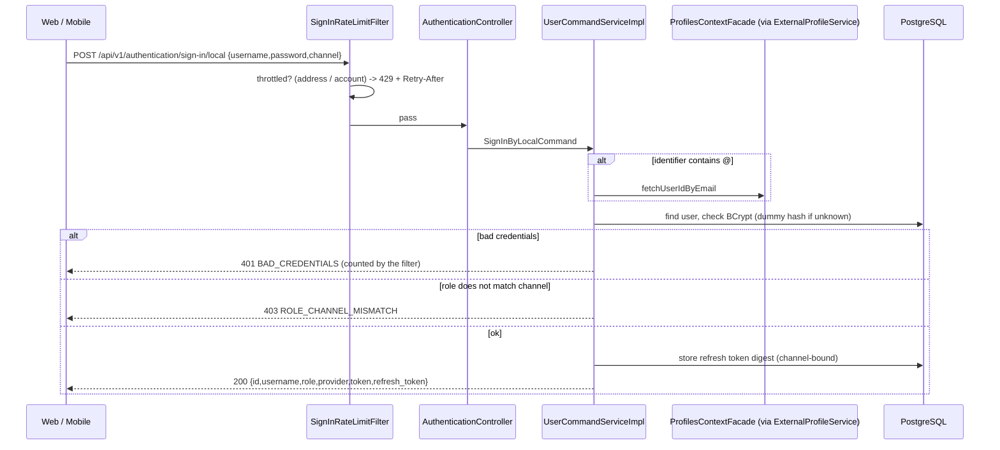
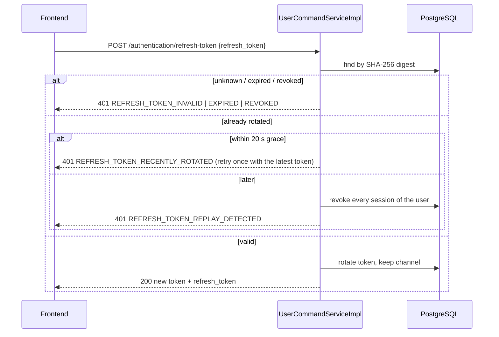
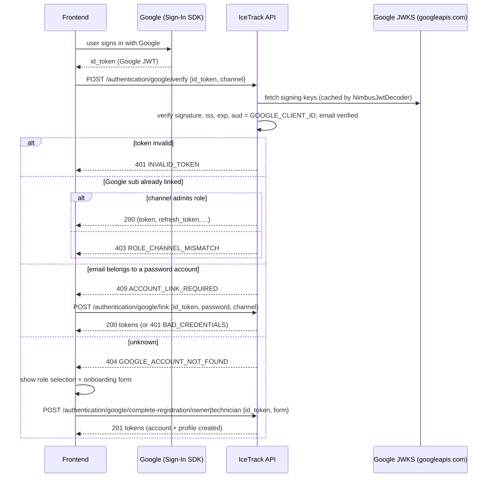
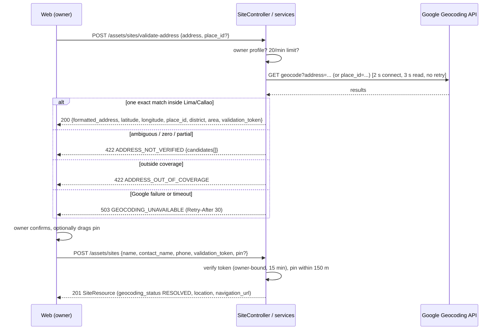
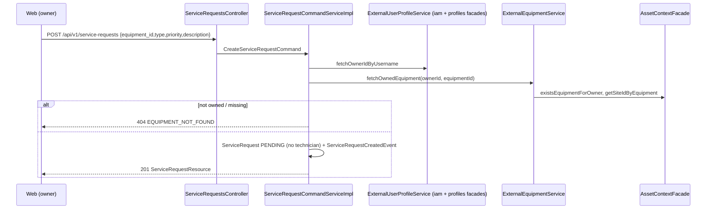
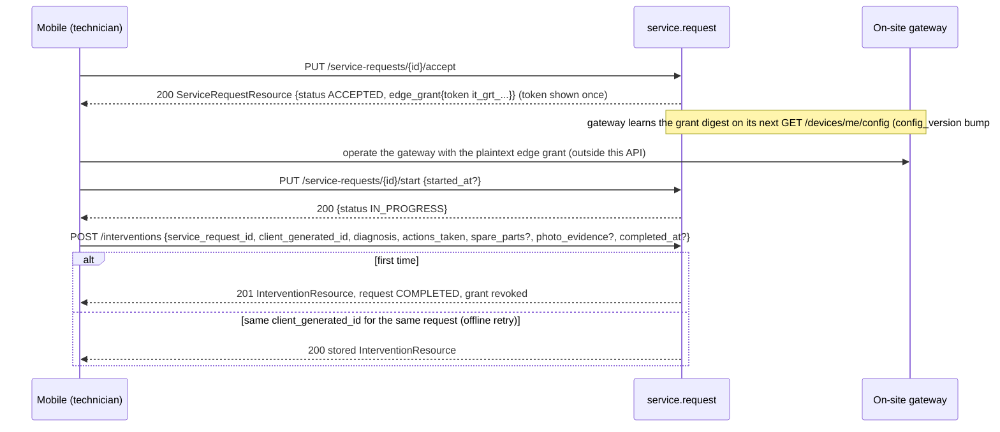
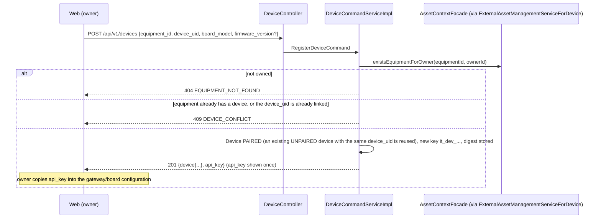
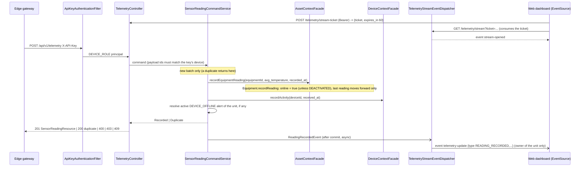
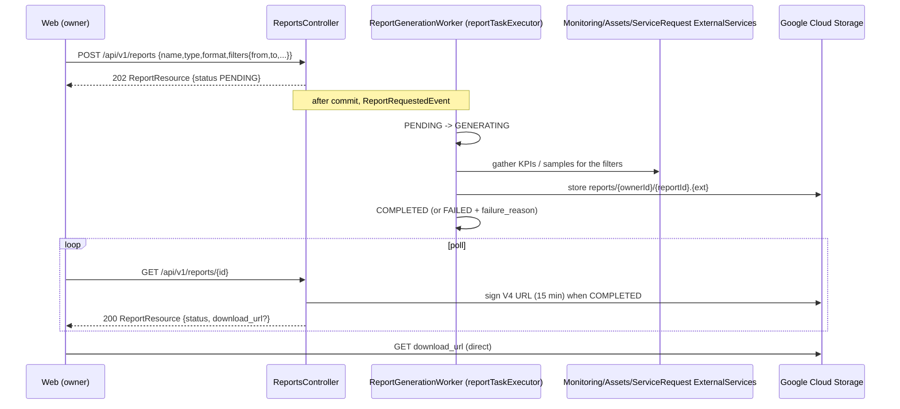
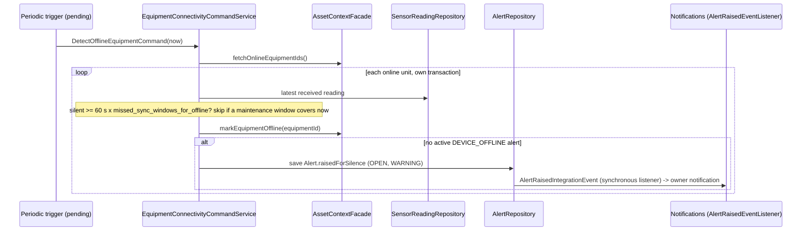

# Sequence diagrams

Every diagram below is traced to classes in the repository (named in the text under each). Diagrams 1, 2 and 4 to 12 follow flows that were also exercised over HTTP against a locally running backend (diagram 13 is covered by unit tests only, because nothing triggers it yet); the arrows marked asynchronous are drawn from the code, and their timing was not validated. Participants named `Facade` are the inbound ACL classes of the target context; "ExternalService" classes live in the calling context. Mermaid syntax; render with any Mermaid viewer.

Contents: [1 Username/password sign-in](#1-usernamepassword-sign-in) | [2 Token refresh](#2-token-refresh) | [3 Google authentication](#google-authentication) | [4 Equipment registration](#4-equipment-registration) | [5 Site address validation and registration](#5-site-address-validation-and-site-registration) | [6 Service request creation](#6-service-request-creation) | [7 Technician assignment](#7-technician-assignment) | [8 Acceptance, start and completion](#8-service-acceptance-start-and-completion) | [9 Device pairing](#9-device-pairing) | [10 Telemetry processing](#10-telemetry-ingestion-and-live-stream) | [11 Alert and notification](#11-thermal-alert-to-notification-and-push) | [12 Report generation](#12-report-generation-and-file-retrieval) | [13 Device offline detection](#13-device-offline-detection-and-recovery)

## 1. Username/password sign-in

Classes: `AuthenticationController.signIn`, `UserCommandServiceImpl.handle(SignInByLocalCommand)`, `SignInRateLimitFilter`.



## 2. Token refresh

Classes: `UserCommandServiceImpl.handle(RefreshTokenCommand)`, `AuthenticationExceptionHandler`.



## Google authentication

Classes: `AuthenticationController.verifyGoogleAccount|linkGoogleAccount|completeGoogle*Registration`, `GoogleTokenServiceImpl`, `UserCommandServiceImpl`.



## 4. Equipment registration

Classes: `EquipmentController.registerEquipment`, `EquipmentCommandServiceImpl`, `AssetsExternalOwnerService`, `EquipmentRegisteredEventHandler`.

```mermaid
sequenceDiagram
  participant FE as Web (owner)
  participant C as EquipmentController
  participant S as EquipmentCommandServiceImpl
  participant X as AssetsExternalOwnerService
  participant IAM as IamContextFacade
  participant PRO as ProfilesContextFacade
  participant DB as PostgreSQL
  FE->>C: POST /api/v1/assets/equipments {site_id,uid,name,equipment_type,min_celsius,max_celsius,reminder_interval_days}
  C->>S: RegisterEquipmentCommand (after @Valid)
  S->>X: fetchOwnerIdByUsername
  X->>IAM: fetchUserIdByUsername
  X->>PRO: fetchOwnerIdByUserId
  X-->>S: owner id (none -> 403)
  S->>DB: site reachable by owner? (none -> 404) ; uid unique? (-> 409)
  S->>DB: save Equipment (ACTIVE, online=false, config_version)
  S-->>C: EquipmentRegisteredEvent -> site equipment_count + 1
  C-->>FE: 201 EquipmentResource
```

## 5. Site address validation and site registration

Classes: `SiteController.validateAddress|registerSite`, `AddressValidationCommandServiceImpl`, `GoogleMapsGeocodingAdapter`, `AddressValidationTokenService`, `SiteCommandServiceImpl`.



## 6. Service request creation

Classes: `ServiceRequestsController.createServiceRequest`, `ServiceRequestCommandServiceImpl`, `ExternalUserProfileService`, `ExternalEquipmentService`.



## 7. Technician assignment

Classes: `ServiceRequestsController.assignTechnician`, `ServiceRequestCommandServiceImpl`, `ExternalUserProfileService.isTechnicianEligibleForAssignment`, `ServiceRequestOutboxEventHandler`, `ServiceRequestNotificationEventListener`.

```mermaid
sequenceDiagram
  participant FE as Web (owner)
  participant S as ServiceRequestCommandServiceImpl
  participant P as ProfilesContextFacade
  participant OB as outbox_events
  participant N as Notifications
  participant M as Mobile (technician)
  FE->>S: PUT /service-requests/{id}/assign {technician_profile_id}
  S->>P: isTechnicianEligibleForAssignment (via ExternalUserProfileService; the facade only checks that the technician profile exists)
  alt not eligible
    S-->>FE: 409 TECHNICIAN_NOT_ELIGIBLE
  else request not PENDING/ACCEPTED
    S-->>FE: 409 INVALID_STATUS_TRANSITION
  else
    S->>S: status PENDING, previous grant revoked
    S->>OB: TechnicianAssignedIntegrationEvent (same transaction)
    S-->>FE: 200 ServiceRequestResource
    OB-->>N: dispatcher (every 2 s) -> notification to the technician
    N-->>M: FCM push (if a device token is registered)
  end
```

## 8. Service acceptance, start and completion

Classes: `ServiceRequestsController.acceptServiceRequest|startServiceRequest`, `InterventionsController.registerIntervention`, `EdgeGrantTokenService`.



## 9. Device pairing

Classes: `DeviceController.registerDevice`, `DeviceCommandServiceImpl`, `ExternalAssetManagementServiceForDevice`, `DeviceCredentialService`.



## 10. Telemetry ingestion and live stream

Classes: `EdgeSecurityConfiguration`, `ApiKeyAuthenticationFilter`, `TelemetryController.recordReading`, `SensorReadingCommandService`, `ExternalAssetManagementService` -> `AssetContextFacade`, `ExternalDeviceServiceForMonitoring` -> `DeviceContextFacade`, `TelemetryStreamEventDispatcher`, `TelemetryStreamRegistry`, `TelemetryStreamController`.

The connectivity updates run synchronously, inside the ingestion transaction: they commit with the reading or not at all, and a duplicate batch changes none of them.



## 11. Thermal alert to notification and push

Classes: `EdgeEventsController.recordEvent`, `EdgeEventCommandService`, `AlertRaisedEventHandler`, `AlertRaisedEventListener`, `NotificationCommandServiceImpl`, `NotificationCreatedEventHandler`, `FcmPushGateway`.

```mermaid
sequenceDiagram
  participant GW as Edge gateway
  participant M as monitoring
  participant N as notifications
  participant A as AssetContextFacade
  participant FCM as Firebase Cloud Messaging
  participant FE as Owner web/mobile
  GW->>M: POST /telemetry/events {event_uid, type THERMAL_EXCURSION_DETECTED, occurred_at, temperature_celsius}
  M->>M: dedupe by event_uid; maintenance window? active alert?
  M-->>GW: 201 ALERT_OPENED (or 200 ALERT_ALREADY_ACTIVE / SUPPRESSED_BY_MAINTENANCE)
  M->>N: AlertRaisedIntegrationEvent (in-process @EventListener: synchronous, same thread and transaction as the POST)
  N->>A: getEquipmentOwnerId (via ExternalAssetManagementServiceForNotifications)
  N->>N: save Notification (English text) -> NotificationCreatedEvent
  N-)FCM: after NotificationCreatedEvent, a separate @Async handler sends the multicast push (only this step is asynchronous)
  FCM-)FE: push {notification_id, type, severity, equipment_id, alert_id}
  FE->>N: GET /notifications, GET /alerts/{id}, PUT /alerts/{id}/acknowledge
```

## 12. Report generation and file retrieval

Classes: `ReportsController`, `ReportCommandServiceImpl`, `ReportGenerationWorker`, `ReportFileStorage` (`GcsReportFileStorage`), `ReportQueryServiceImpl`.



## 13. Device offline detection and recovery

Classes: `EquipmentConnectivityCommandService` (`DetectOfflineEquipmentCommand`), `AlertPolicy.isOfflineSince`, `Alert.raisedForSilence`, `ExternalAssetManagementService` -> `AssetContextFacade.fetchOnlineEquipmentIds` / `markEquipmentOffline`, `AlertRaisedEventHandler`, `AlertRaisedEventListener` (notifications).

**Pending:** nothing invokes the detection periodically yet; the trigger belongs to the development team. The recovery half (diagram 10) runs on every reading.



